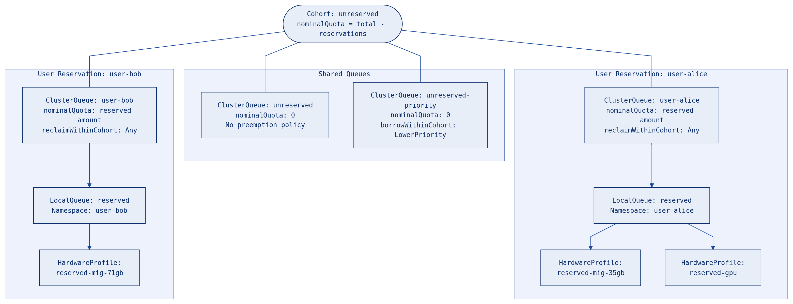
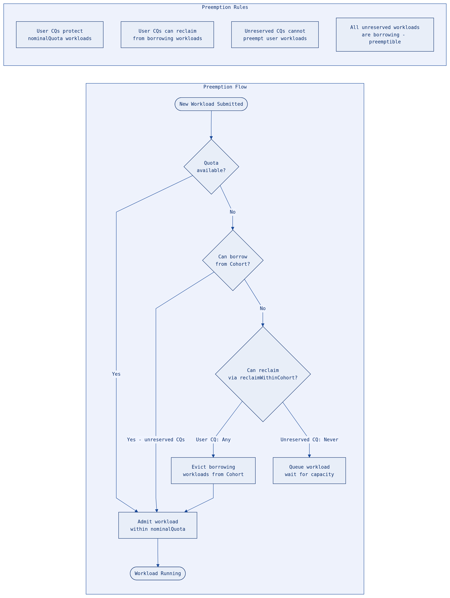
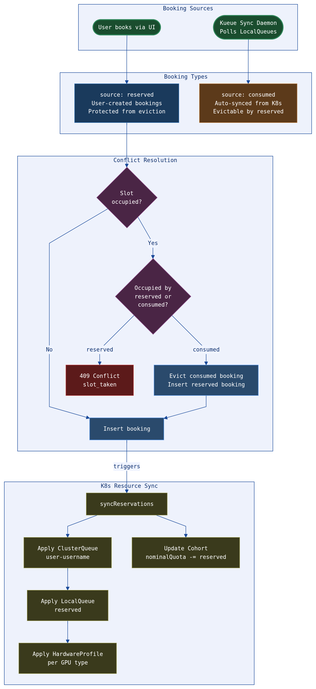
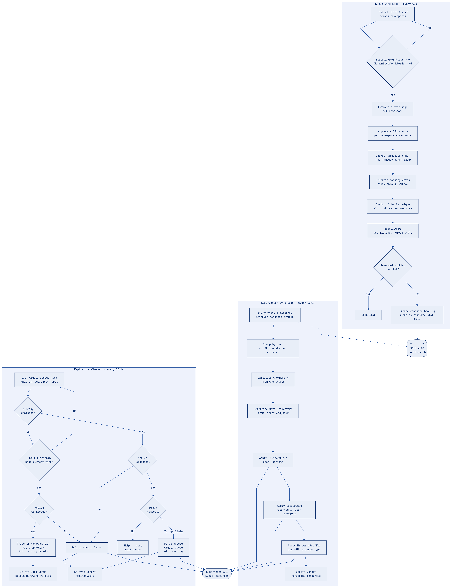

# GPU Booking Console Plugin Architecture

This document describes the architecture of the GPU Booking OpenShift Console Dynamic Plugin, covering the frontend integration, Go backend, Kueue-based reservation system, and deployment model.

## System Overview

The GPU Booking Console Plugin is an OpenShift Console Dynamic Plugin that manages GPU resources with optional MIG (Multi-Instance GPU) partitioning, backed by Kubernetes [DRA](https://kubernetes.io/docs/concepts/scheduling-eviction/dynamic-resource-allocation/) (Dynamic Resource Allocation) on DRA-enabled clusters. GPU types, counts, and cluster capacity are auto-discovered from Kubernetes node labels, allocatable resources, and DRA ResourceSlices. It runs as a single pod serving both a React frontend (loaded into the OpenShift console) and a Go API backend. The system combines user-facing reservations with automatic Kueue workload tracking and an admission-check enforcer to provide a unified — and on DRA clusters, **enforced** — view of GPU allocation.

**Key components:**
- **Console Plugin** (React/PatternFly v6 frontend) - loaded into OpenShift console via `ConsolePlugin` CR
- **Go Backend** (API server on port 9443) - booking API, Kueue sync, reservation management, DRA discovery
- **Kueue** - Kubernetes-native job queueing with quota management (ClusterQueues, Cohorts, Workloads, AdmissionChecks)
- **DRA** - ResourceSlices/DeviceClasses/ResourceClaims for device inventory and allocation
- **Booker Enforcer** - a Kueue AdmissionCheck reconciled by the backend that makes bookings non-advisory (see [docs/DRA-KUEUE.md](docs/DRA-KUEUE.md))
- **SQLite** - persistent booking storage (WAL mode)
- **OpenShift Console Proxy** - authentication via `UserToken` proxy type

```
+------------------------------------------------------------------+
| OpenShift Console                                                |
|                                                                  |
|  +------------------------------------------------+              |
|  | GPU Booking Plugin (React/PF6)                 |              |
|  |   BookingPage | AdminPage | HelpPage           |              |
|  +-----------+------------------------------------+              |
|              | /api/proxy/plugin/gpu-booking-plugin/backend/api  |
|              | (Bearer token injected by console)                |
|  +-----------v------------------------------------+              |
|  | Console Proxy (UserToken)                      |              |
|  +-----------+------------------------------------+              |
+--------------+---------------------------------------------------+
               |
  +------------v------------------------------------------------+
  | GPU Booking Pod (:9443 TLS)                                  |
  |                                                              |
  |  Go Backend                                                  |
  |  +-- Auth Middleware (TokenReview + SubjectAccessReview)     |
  |  +-- Booking API (CRUD, bulk, conflict resolution)           |
  |  +-- Admin API (list, delete, export/import DB)              |
  |  +-- Kueue Sync Loop (30s - consumed bookings)               |
  |  +-- Reservation Sync Loop (10m - K8s resources)             |
  |  +-- Expiry Cleaner (10m - stale ClusterQueues)              |
  |  +-- Static Asset Server (plugin dist/)                      |
  |                                                              |
  |  SQLite DB (/app/data/bookings.db)                           |
  +--------------------------------------------------------------+
```

## Frontend Architecture

The frontend is a React application using PatternFly v6 components, bundled via webpack and loaded into the OpenShift console as a dynamic plugin.

### Console Integration

**Plugin registration** (`console-extensions.json`):

| Extension Type | Details |
|---------------|---------|
| `console.navigation/section` | "GPU Booking" nav section in admin perspective |
| `console.page/route` `/gpu-booking/bookings` | Main booking page |
| `console.page/route` `/gpu-booking/admin` | Admin dashboard |
| `console.page/route` `/gpu-booking/help/:topic?` | Help documentation |
| `console.navigation/href` | Nav links: Bookings, Administration, Help |

**Exposed modules** (`package.json`):
- `BookingPage` - main booking interface
- `AdminPage` - admin dashboard
- `HelpPage` - help documentation

### Components

| Component | Purpose |
|-----------|---------|
| `BookingPage.tsx` | Main page: calendar + resource selector + booking grid + usage panel. Supports multi-select dates (Ctrl/Shift click), "My Bookings" filter, and bulk booking modal |
| `BookingGrid.tsx` | Per-resource slot grid showing reserved/consumed/available units with Reserve/Cancel/Edit/Override buttons |
| `BookingModal.tsx` | Modal for multi-day GPU reservations with date range, time range, and resource quantity selectors |
| `CalendarGrid.tsx` | Interactive month calendar with booking density indicators and date multi-select |
| `ResourceSelector.tsx` | Card gallery for GPU resource type selection (auto-discovered) with GPU equivalent weights |
| `GpuUsagePanel.tsx` | Real-time usage bar chart showing consumed/reserved/free slots per resource type with hover-to-reveal usernames |
| `PreemptionBanner.tsx` | Collapsible banner showing preempted Kueue workloads with owner, reason, message, and timestamp. Hidden when none |
| `AdminPage.tsx` | Admin: view all bookings, delete bookings, toggle Kueue sync, export/import database |
| `HelpPage.tsx` | Markdown-based help with sidebar navigation, 8 topic pages, prev/next pagination |

### Authentication Context

`AuthContext.tsx` provides user identity to all components:
1. Calls `GET /api/auth/me` with the console-injected Bearer token
2. Returns `{ username, groups, is_admin }`
3. Cached for 30 seconds client-side to pick up auth changes
4. Admin status drives visibility of admin panel and override buttons

### Routing

Routing is router-agnostic: the console shares `react-router-dom` at runtime, and console versions providing react-router v6+ (no `useHistory`) break hook imports. HelpPage therefore reads the active topic from `window.location.pathname` and navigates via local component state + `history.pushState`, with a `popstate` listener for browser back/forward. Route params are never taken from `useParams`, as the console SDK routing does not reliably trigger re-renders with it.

## Backend Architecture

The Go backend serves the plugin's static assets and REST API on port 9443 with TLS (via OpenShift service-serving certificates).

### Project Structure

```
cmd/
└── backend/main.go          # Entry point (console plugin backend), loop startup

pkg/
├── api/
│   ├── main.go             # HTTP router, static file serving, middleware
│   ├── auth.go             # TokenReview + SubjectAccessReview, 5m cache
│   ├── bookings.go         # GET/POST/DELETE bookings, bulk booking
│   ├── admin.go            # Admin list, delete, DB export/import
│   ├── config.go           # GPU specs, booking window, cluster capacity
│   ├── workloads.go        # Preempted workloads API handler
│   └── helpers.go          # JSON response helpers
├── database/
│   └── database.go         # SQLite schema, CRUD operations, WAL mode
└── kube/
    ├── kueue.go            # Kueue LocalQueue sync → consumed bookings, claim attribution
    ├── reservations.go     # K8s resource sync (CQ/LQ/HardwareProfile/RCT), Cohort math
    ├── discovery.go        # GPU discovery (nodes + DRA ResourceSlices → catalog lanes)
    ├── dra.go              # ResourceSlice parsing, per-node device counts, consumable shares
    ├── deviceclasses.go    # per-profile MIG DeviceClass provisioning + GC (C1)
    └── admissioncheck.go   # the "booker" AdmissionCheck enforcer
```

### Authentication Flow

The console's `UserToken` proxy forwards the logged-in user's Bearer token to the backend. The auth middleware:

1. Extracts the Bearer token from the `Authorization` header
2. Validates via Kubernetes `TokenReview` API → extracts `username` and `groups`
3. Checks admin status via `SubjectAccessReview` for `gpubooking.openshift.io/bookings` with verb `admin`
4. Caches results for 5 minutes keyed by SHA256 token hash
5. Injects `username`, `groups`, and `is_admin` into the request context

**Important:** Console impersonation does NOT affect plugin proxy calls. The `UserToken` proxy always sends the logged-in user's actual token. Impersonation headers (`Impersonate-User`) are only forwarded for direct Kubernetes API calls.

### API Routes

```
GET    /api/auth/me                  → current user info (username, groups, is_admin)
GET    /api/config                   → GPU specs, booking window, cluster capacity
GET    /api/bookings                 → all bookings + active reservations + current user
POST   /api/bookings                 → create single booking (conflict resolution; cluster/namespace admins may pass targetNamespace for system bookings)
DELETE /api/bookings?id=             → cancel booking (owner or admin only)
POST   /api/bookings/bulk            → create multi-day bookings (date range + resource counts; cluster/namespace admin targetNamespace supported)
GET    /api/workloads/preempted      → list Kueue workloads with Preempted/Evicted conditions
GET    /api/admin                    → all bookings (admin only)
DELETE /api/admin?id=                → delete booking (admin only)
POST   /api/admin/reservations       → toggle Kueue sync (admin only)
GET    /api/admin/database/export    → download database JSON (admin only)
POST   /api/admin/database/import    → restore database (admin only)
GET    /api/health                   → health check + namespace
```

### Username Sanitization

The console plugin receives full email addresses from `TokenReview` (e.g. `cluster-admin@redhat.com`), whereas the original standalone app received short usernames from OAuth proxy `X-Forwarded-User`. Kubernetes resource names must be valid RFC 1123 DNS labels, so:

- `@` and domain are stripped: `cluster-admin@redhat.com` → `mhepburn`
- Invalid characters replaced with `-`
- Result trimmed of leading/trailing `-` and `.`
- Truncated to 253 characters

This ensures `user-mhepburn` namespaces and ClusterQueues match the existing convention.

## GPU Resource Pool

GPU resources are auto-discovered by two complementary mechanisms.

### Device-plugin discovery (nodes)

The discovery module (`pkg/kube/discovery.go`) queries Kubernetes nodes with the `nvidia.com/gpu.present=true` label and extracts:

- **GPU product and memory** from node labels (`nvidia.com/gpu.product`, `nvidia.com/gpu.memory`)
- **GPU and MIG counts** from `status.allocatable` resources (`nvidia.com/gpu`, `nvidia.com/mig-*`)
- **Kueue ResourceFlavor names** from the Kueue API (used for reservation ClusterQueue flavors)
- **Total CPU and memory** summed across all GPU nodes

GPU equivalent weights for MIG slices are calculated automatically as `mig_memory / full_gpu_memory`. The `share` field (fraction of total CPU/memory per unit) is derived from `gpuEquivalent / total_equivalent_units`.

### DRA discovery (ResourceSlices)

On DRA-enabled clusters (`pkg/kube/dra.go`), discovery additionally lists `resource.k8s.io` **ResourceSlices** — the DRA driver's per-node device inventory — and classifies devices into catalog lanes (see [docs/DRA-KUEUE.md](docs/DRA-KUEUE.md) §2):

- whole boards (`type=gpu`, including flex parents carrying full-board `consumesCounters`) → the dedicated lane
- MIG partitions (`type=mig` + `profile` attribute) → per-profile lanes
- counter-set definers and menu-filtered profiles → skipped

From the same data the discovery sync provisions **per-profile DeviceClasses** (`mig.nvidia.com-<dashed-profile>`, `pkg/kube/deviceclasses.go`) with CEL selectors on driver/type/profile, managed via label and GC'd when a lane leaves the catalog. Workloads claiming a per-profile class charge that profile's own quota lane through the Kueue `deviceClassMappings`; the folded `gpu.nvidia.com` / `mig.nvidia.com` classes remain as the whole-lane fallback. Per-profile classes are what make per-profile Kueue quota mappings possible (one DeviceClass → one logical quota name).

Discovery runs at startup (synchronously, before Kueue/reservation sync) and then periodically (default: every 5 minutes). The configuration is stored in a thread-safe `atomic.Pointer[GPUConfig]` so concurrent readers always see a consistent snapshot. Administrators can trigger immediate re-discovery via `POST /api/admin/discover`.

Discovery assumes a **homogeneous GPU cluster** — all GPU nodes have the same GPU product. In heterogeneous clusters (e.g., mixed A100 and H100 nodes), all `nvidia.com/gpu` resources are aggregated into a single "Full GPU" entry using the product name from the first node returned by the API. MIG gpuEquivalent ratios are calculated against that first node's GPU memory. Per-product grouping is not currently supported.

When auto-discovery is disabled (`GPU_DISCOVERY_ENABLED=false`), the backend falls back to a static ConfigMap (`gpu-booking-plugin-gpu-config`) mounted at `/app/config/gpu-config.json`, or built-in defaults if neither is available. The static config path supports heterogeneous clusters — you can define multiple full GPU entries (e.g., A100 and H100) with independent names, counts, shares, and gpuEquivalent weights in the same config file.

## Kueue Resource Hierarchy

All Kueue resources share a single flat Cohort. User reservations carve out protected quota from the shared pool.



### Resource Relationships

When a user has an active reservation, up to four kinds of Kubernetes resources are created:

1. **ClusterQueue** (`user-<username>` or `system-<namespace>`) - joins the `unreserved` cohort, scoped to the namespace. Holds the reserved `nominalQuota` for CPU, memory, and GPU resources. With the booker enforcer enabled it references the `booker` AdmissionCheck — via `admissionChecksStrategy`, the **only form this operand persists** (a plain `spec.admissionChecks` list is silently dropped). Labeled with `rhai-tmm.dev/until` for expiry tracking. On expiry, the ClusterQueue is gracefully drained via `stopPolicy: HoldAndDrain` before deletion (see Expiration Cleaner below).

2. **LocalQueue** (`reserved`) - lives in the `user-<username>` namespace and points to the user's ClusterQueue. This is the queue users submit reserved workloads to.

3. **HardwareProfile(s)** - one per GPU resource type reserved (e.g. `reserved-gpu`, `reserved-mig-35gb`). Lives in the user's namespace and references the `reserved` LocalQueue. Uses API group `infrastructure.opendatahub.io`. Provides the scheduling interface for OpenDataHub/RHOAI workbenches.

4. **ResourceClaimTemplates** (DRA mode) - namespaced `reserved-<lane>-rct` templates referenced by the DRA HardwareProfiles, so admitted workloads get real DRA ResourceClaims.

### System Bookings

Cluster administrators and **namespace administrators** (users who can create RoleBindings in the target namespace — verified via a namespace-scoped SubjectAccessReview) can create **system bookings** for a namespace rather than for themselves (e.g. `shared-maas` for shared MaaS model-serving capacity). This lets a team of namespace admins manage reservations for their shared namespace without cluster-wide admin rights. System bookings are created via `POST /api/bookings` or `/api/bookings/bulk` with a `targetNamespace` field. The target namespace must exist in the cluster (verified at booking time), and the requester must be able to administer it.

- Bookings are stored with `booking_type = 'system'`; the `user` column holds the target namespace and the `email` column holds the creating user's username.
- **ClusterQueue** (`system-<namespace>`) - scoped to the existing target namespace via its namespaceSelector, labeled `rhai-tmm.dev/namespace` so cleanup can locate the namespace-scoped resources.
- **LocalQueue** (`reserved`) and **HardwareProfile(s)** are created inside the target namespace.
- System reservations follow the same conflict rules (they block user reservations, evict consumed slots), share the same Cohort accounting, and expire/drain through the same `until` label mechanism.
- System bookings may be cancelled by their creator (`email`), any admin of the target namespace, or a cluster admin (`canManageBooking`).

### Quota Flow

```
Total GPU Pool (values.yaml: totalResources)
    |
    |- User reservations subtracted (per-user nominalQuota)
    |
    v
Remaining = Cohort nominalQuota (shared pool)
    |
    |- ClusterQueue: unreserved (nominalQuota: 0, borrows from Cohort,
    |                carries the booker AdmissionCheck on DRA clusters)
    |- ClusterQueue: unreserved-priority (nominalQuota: 0, borrows from Cohort)
    |- ClusterQueue: user-alice (nominalQuota: reserved amount)
    |- ClusterQueue: user-bob (nominalQuota: reserved amount)
```

The booking plugin re-derives the Cohort's remaining quota from the catalog and active bookings on every sync (`applyCohortRemaining`) — a reservation shrinks the borrowable pool, which is what triggers Kueue's own `reclaimWithinCohort` preemption.

## Preemption Model

The preemption design ensures user reservations are pre-eminent over unreserved workloads.



| Queue Type | `reclaimWithinCohort` | `borrowWithinCohort` | Effect |
|---|---|---|---|
| `user-<name>` | `Any` | `Never` | Can reclaim quota from borrowing workloads; cannot borrow beyond reservation |
| `unreserved` | (none) | (none) | Cannot preempt anyone; all workloads are borrowing |
| `unreserved-priority` | (none) | `LowerPriority` (threshold 100) | Can preempt low-priority borrowing workloads only |

**Key guarantees:**
- Workloads within a user's `nominalQuota` are **never preemptible** (they are not "borrowing")
- User CQs can **reclaim** from any workload borrowing from the Cohort (all unreserved workloads)
- Unreserved CQs **cannot preempt** user workloads because they have no reclaim policy
- Beyond their reservation, users compete fairly with no preemption rights

**DRA caveat:** on DRA clusters this operand's preemption decisions are quota-only — it does not model device feasibility or free held claims at preemption time. The **booker enforcer** ([docs/DRA-KUEUE.md](docs/DRA-KUEUE.md) §4) supplies the missing enforcement: it gates uncovered workloads before admission, evicts on booking expiry, and deposes unbooked holders when a booking needs their capacity — on any operand, without waiting for upstream DRA-aware preemption.

## Consumed vs Reserved Bookings

The system tracks two types of bookings that interact through a priority-based conflict resolution model.



| Property | Reserved | Consumed |
|----------|----------|----------|
| **Source** | `"reserved"` | `"consumed"` |
| **Created by** | Users via booking UI | Kueue sync daemon |
| **Evictable** | No (blocks other reservations) | Yes (evicted by reserved bookings) |
| **Cancellable** | Yes (by owner or admin) | No (admin only; repopulated on next sync) |
| **ID format** | UUID | `kueue-{namespace}-{resource}-s{slot}-{date}` |
| **Triggers K8s sync** | Yes (creates ClusterQueue/LocalQueue/HardwareProfile) | No (reflects existing K8s state) |

### Conflict Resolution Rules

1. **Empty slot** - booking proceeds normally
2. **Slot occupied by `consumed`** - consumed booking is evicted, reserved booking takes its place. This reduces the unreserved Cohort and triggers Kueue workload preemption.
3. **Slot occupied by `reserved`** - returns `409 Conflict` (`slot_taken`), regardless of whether the existing booking is a user or system booking
4. **Database uniqueness** - `UNIQUE(resource, slot_index, date, slot_type)` constraint prevents exact duplicates

### Booking Types

Every booking has a `booking_type`: `user` (created by a logged-in user for themselves) or `system` (created by an admin for a namespace). Both types use `source = "reserved"` and follow identical conflict, preemption, and expiry semantics — the type only controls how the reservation sync names the ClusterQueue (`user-<name>` vs `system-<namespace>`) and which namespace the LocalQueue/HardwareProfiles are created in.

## Sync Lifecycle

Four independent loops run concurrently in the Go backend (plus event-driven reservation syncs).



### 1. Kueue Sync Loop (every 30s)

**File:** `pkg/kube/kueue.go`
**Controlled by:** `KUEUE_SYNC_ENABLED`, `KUEUE_SYNC_INTERVAL`

Polls all LocalQueues in the cluster and creates `consumed` bookings reflecting actual GPU usage:

- Lists LocalQueues via `kueue.x-k8s.io/v1beta1` API
- Filters for queues with active workloads (`reservingWorkloads > 0` or `admittedWorkloads > 0`)
- Reads `flavorUsage` to determine GPU resource counts per namespace
- Aggregates across multiple LocalQueues in the same namespace (e.g. `default`, `unreserved`, `unreserved-priority`)
- Assigns globally unique slot indices per resource to avoid UNIQUE constraint collisions
- Resolves namespace `rhai-tmm.dev/owner` label as booking owner (falls back to namespace name)
- Books from today through `KUEUE_BOOKING_DAYS` days ahead
- Reconciles: adds missing bookings, removes stale future bookings, skips slots already reserved
- Historical bookings (past dates) are preserved

### 2. Reservation Sync Loop (event-driven + 2m cleaner)

**File:** `pkg/kube/reservations.go`
**Controlled by:** Runtime toggle via `POST /api/admin/reservations` (enabled by default)

Materializes Kueue resources (ClusterQueue, LocalQueue, HardwareProfile) for today's reserved bookings:

- Queries today's and tomorrow's `reserved` bookings from SQLite
- Groups by user, sums GPU counts per resource type
- Calculates CPU/memory allocation from GPU share ratios
- Determines `until` timestamp from the latest `end_hour`
- Applies ClusterQueue, LocalQueue, and HardwareProfile(s) via server-side apply
- Updates the `unreserved` Cohort's `nominalQuota` with remaining resources

### 3. Expiration Cleaner (every 2min)

**File:** `pkg/kube/reservations.go`

Cleans up expired Kueue resources using a graceful two-phase drain process, following the [Kueue ClusterQueue deletion procedure](https://kueue.sigs.k8s.io/docs/tasks/troubleshooting/troubleshooting_delete_clusterqueue):

- Lists all ClusterQueues with the `rhai-tmm.dev/until` label
- Also removes resources for users who no longer have active bookings (`removeStaleReservations`)

**Phase 1 — Drain:** When a ClusterQueue expires or becomes stale and has active workloads:
- Sets `spec.stopPolicy: HoldAndDrain` on the ClusterQueue (stops new admissions, evicts admitted workloads)
- Adds labels `rhai-tmm.dev/draining: "true"` and `rhai-tmm.dev/drain-start: <unix-timestamp>`
- Immediately deletes the associated LocalQueue and HardwareProfiles (prevents new workload submissions)

**Phase 2 — Delete:** On subsequent cleaner cycles, draining ClusterQueues are checked:
- If `admittedWorkloads + pendingWorkloads + reservingWorkloads == 0` → ClusterQueue is deleted
- If the drain timeout (30 minutes) has elapsed → ClusterQueue is force-deleted with a warning log
- Otherwise, the queue remains in draining state until the next cycle

If the ClusterQueue has **no active workloads** at expiry time, it is deleted immediately (skipping the drain phase).

The Cohort `nominalQuota` is re-synced after cleanup.

### Async Sync Triggers

In addition to the periodic loops, reservation sync is triggered asynchronously (via `go syncReservations()`) after:

- Creating a booking (`POST /api/bookings`)
- Deleting a booking (`DELETE /api/bookings`)
- Admin deleting a booking (`DELETE /api/admin`)
- Bulk booking creation (`POST /api/bookings/bulk`)
- Database import (`POST /api/admin/database/import`)

### 4. Booker Enforcer Loop (every 30s)

**File:** `pkg/kube/admissioncheck.go`
**Controlled by:** `BOOKER_ENFORCER_ENABLED` (chart default `true`), `BOOKER_ENFORCER_INTERVAL`

Reconciles the plugin-owned **`booker` AdmissionCheck** across both GPU lanes — this is what turns reservations from advisory into enforced:

- Ensures the AdmissionCheck object exists and is **Active** (for custom checks the Active condition is the controller's job; Kueue refuses to admit workloads referencing an inactive check)
- Ensures the check is wired into the static `unreserved` ClusterQueue (strategy form, append-only — self-healing)
- Lists workloads on the `reserved` and `unreserved` LocalQueues cluster-wide, resolves each workload's DRA lane charges from its ResourceClaimTemplates
- Evaluates the unified FIFO policy (booking coverage → free-capacity budget → per-node shape cap — full policy in [docs/DRA-KUEUE.md](docs/DRA-KUEUE.md) §4) and patches each workload's check state: `Ready` (run) or `Pending` (gated, with an actionable message)
- Deactivates stale admitted workloads that stay admitted after a gating message was patched (admitted before the check existed — Kueue has no transition to evict on), releasing quota and DRA claims; the Deployment's replacement then hits the check like any fresh workload

The state patch itself is the eviction trigger: Kueue holds gated pods and evicts admitted workloads when a check leaves `Ready` — booking expiry and make-room preemption are the same flip.

## Deployment Architecture

The application deploys as a single Kubernetes pod with one container, managed by a Helm chart in `chart/`.

### Container Build (Multi-stage)

```
Stage 1: frontend-builder (UBI9 Node.js 22)
  └── yarn build → dist/ (webpack + ConsoleRemotePlugin)

Stage 2: backend-builder (UBI9 Go 1.25)
  └── CGO_ENABLED=1 go build → /backend (SQLite requires CGO)

Stage 3: final (UBI9 ubi-minimal)
  ├── /app/backend (Go binary)
  ├── /app/dist/ (plugin static assets)
  ├── /app/data/bookings.db (SQLite, PVC-backed)
  ├── /app/config/gpu-config.json (ConfigMap-mounted GPU config)
  └── Port 9443 (TLS via service-serving certs)
```

### Kubernetes Resources

| Resource | Details |
|----------|---------|
| **Deployment** | Single replica, non-root (UID 1001), read-only rootfs, liveness/readiness on `/api/health` |
| **ConsolePlugin** CR | Registers plugin with OpenShift console, `UserToken` proxy type, service backend |
| **Service** | ClusterIP on port 9443, `service.beta.openshift.io/serving-cert-secret-name` annotation |
| **ConfigMap** | GPU resource configuration (`gpu-config.json`), mounted at `/app/config` |
| **PVC** | 2Gi for SQLite database persistence |
| **ServiceAccount** | With RBAC for Kueue, DRA, namespace, auth, and HardwareProfile APIs |
| **ClusterRole** | `localqueues`, `clusterqueues` (+`/status`), `cohorts`, `workloads` (+`/status`), `admissionchecks` (+`/status`) (Kueue); `resourceslices`, `resourceclaims`, `resourceclaimtemplates`, `deviceclasses` (DRA); `namespaces`, `tokenreviews`, `subjectaccessreviews` (K8s); `hardwareprofiles` (OpenDataHub) |
| **Console Patch** | Enables plugin in the `Console` operator config |

### RBAC

The plugin's ServiceAccount requires:

| API Group | Resources | Verbs |
|-----------|-----------|-------|
| `kueue.x-k8s.io` | `clusterqueues`, `clusterqueues/status` | get, list, create, patch, delete |
| `kueue.x-k8s.io` | `localqueues` | list, create, patch, delete |
| `kueue.x-k8s.io` | `workloads`, `workloads/status` | list, get, patch, update |
| `kueue.x-k8s.io` | `admissionchecks`, `admissionchecks/status` | get, list, create, patch, update |
| `kueue.x-k8s.io` | `cohorts` | create, patch |
| `resource.k8s.io` | `resourceslices`, `resourceclaims` | get, list |
| `resource.k8s.io` | `resourceclaimtemplates` | get, list, create, patch, delete |
| `resource.k8s.io` | `deviceclasses` | get, list, create, update, patch, delete |
| `""` (core) | `namespaces` | get |
| `authentication.k8s.io` | `tokenreviews` | create |
| `authorization.k8s.io` | `subjectaccessreviews` | create |
| `infrastructure.opendatahub.io` | `hardwareprofiles` | list, create, patch, delete |

The `/status` subresources (`workloads/status`, `admissionchecks/status`, `clusterqueues/status`) need their own RBAC rules — patch on the main resource does not cover them.

Admin access for users is controlled by a separate ClusterRole that grants the `admin` verb on `gpubooking.openshift.io/bookings`. This custom RBAC rule is checked via SubjectAccessReview and is not included in the standard OpenShift `admin` ClusterRole, so project owners do not automatically get booking admin access.

## Help System

The plugin includes a built-in help system with 8 markdown documentation pages:

| Topic | Slug |
|-------|------|
| Getting Started | `getting-started` |
| Calendar & Navigation | `calendar` |
| Making Bookings | `making-bookings` |
| GPU Resources | `gpu-resources` |
| Kueue & Auto-Bookings | `kueue` |
| Admin Dashboard | `admin` |
| Slots & Conflicts | `slots-and-conflicts` |
| FAQ | `faq` |

Markdown files are imported as strings via webpack `asset/source` rule and rendered at runtime with `react-markdown`, `remark-gfm`, and `rehype-raw`. Images are imported as webpack assets and resolved via an `imageMap` registry.

## Testing

The project has unit tests for both backend and frontend. All test commands are available via Makefile targets.

### Running Tests

| Command | Description |
|---------|-------------|
| `make test` | Run all Go + frontend tests |
| `make test-go` | Run Go tests only |
| `make test-frontend` | Run frontend tests only (`vitest`) |
| `make coverage` | Run all tests with coverage reports |
| `make coverage-go` | Go coverage → `coverage-go/coverage.html` |
| `make coverage-frontend` | Frontend coverage → `coverage/index.html` |

### Backend (Go)

Tests use the standard `testing` package with `net/http/httptest` for handler tests and temporary SQLite databases for isolation. Each handler test creates a fresh database via `t.TempDir()` and injects user context to simulate authenticated requests without requiring a Kubernetes cluster.

Test files:

| File | Covers |
|------|--------|
| `pkg/api/validate_test.go` | Booking ID, date, and namespace name validation |
| `pkg/api/helpers_test.go` | JSON response helpers |
| `pkg/api/bookings_test.go` | Booking CRUD, conflict resolution, bulk operations, consumed eviction |
| `pkg/api/system_bookings_test.go` | System booking creation, admin gating, namespace validation, conflicts, activeReservations mapping |
| `pkg/api/admin_test.go` | Admin list/delete/toggle, pagination, filters, DB export/import |
| `pkg/api/auth_test.go` | User context extraction, MeHandler, AuthMiddleware (DevMode, cache, health bypass) |
| `pkg/api/config_test.go` | Config endpoint |
| `pkg/api/ratelimit_test.go` | Per-IP rate limiting and burst behavior |
| `pkg/database/database_test.go` | Init, schema, CRUD, unique constraints, config loading |
| `pkg/kube/reservations_test.go` | Active reservation grouping (user/system/UTC offsets), CQ naming, namespace derivation |
| `pkg/kube/admissioncheck_test.go` | Booker policy: coverage FIFO, unreserved budget + backfill, per-node shape cap, make-room ordering, gate-message discrimination, RCT double-nesting regression |
| `pkg/kube/dra_test.go` | ResourceSlice parsing, device classification, shares |
| `pkg/kube/deviceclasses_test.go` | Per-profile DeviceClass naming + GC selection |
| `pkg/kube/discovery_test.go` | Node + DRA discovery → catalog lanes |
| `pkg/kube/kueue_attrib_test.go` | Consumed-usage claim→lane attribution guard |

**Note:** `pkg/kube/` sync and enforcer functions that require the live Kueue/DRA API are not integration-tested; the pure logic (state assignment, capacity math, parsing, naming) is covered against fixtures and temporary SQLite databases.

### Frontend (TypeScript)

Tests use [Vitest](https://vitest.dev/) with `@testing-library/react-hooks` for hook tests and `vi.mock`/`vi.fn` for API mocking.

Test files:

| File | Covers |
|------|--------|
| `src/utils/constants.test.ts` | Date formatting, weekend detection, month/date range utilities, GPU equivalent calculations, system booking detection |
| `src/utils/api.test.ts` | All API client functions with mocked `fetch`, CSRF token handling, error responses, system booking targetNamespace |
| `src/utils/hooks.test.ts` | `useBookings`, `useConfig`, `usePreemptedWorkloads`, `useClock` — mount, polling, cleanup, error handling |

## Key Files

| File | Purpose |
|------|---------|
| `cmd/backend/main.go` | Entry point, TLS setup, loop startup (kueue sync, reservation sync, discovery, booker enforcer) |
| `pkg/api/main.go` | HTTP router, static assets, middleware chain |
| `pkg/api/auth.go` | TokenReview + SubjectAccessReview auth |
| `pkg/api/bookings.go` | Booking CRUD, conflict resolution, bulk booking |
| `pkg/database/database.go` | SQLite schema, queries, WAL mode |
| `pkg/api/workloads.go` | Preempted workloads API handler |
| `pkg/kube/kueue.go` | Kueue LocalQueue sync → consumed bookings, claim→lane attribution, preempted workload queries |
| `pkg/kube/reservations.go` | K8s resource sync (CQ/LQ/HardwareProfile/RCT), Cohort remaining math, username sanitization |
| `pkg/kube/discovery.go` | GPU discovery (nodes + ResourceSlices → catalog lanes) |
| `pkg/kube/dra.go` | ResourceSlice parsing, per-node device counts, consumable shares |
| `pkg/kube/deviceclasses.go` | Per-profile MIG DeviceClass provisioning + GC |
| `pkg/kube/admissioncheck.go` | The "booker" AdmissionCheck enforcer (lane charges, coverage/budget/shape policy, check states) |
| `docs/DRA-KUEUE.md` | DRA + Kueue enforcement deep dive |
| `src/components/BookingPage.tsx` | Main booking UI |
| `src/components/BookingGrid.tsx` | Per-resource slot grid |
| `src/components/HelpPage.tsx` | Help documentation viewer |
| `src/utils/AuthContext.tsx` | Auth state management with 30s TTL cache |
| `src/docs/topicRegistry.ts` | Help topic definitions and navigation structure |
| `console-extensions.json` | Plugin routes and navigation registration |
| `chart/` | Helm chart (deployment, ConsolePlugin CR, RBAC, PVC, ConfigMap, service) |
