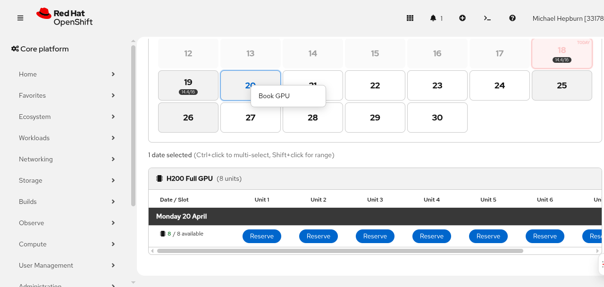
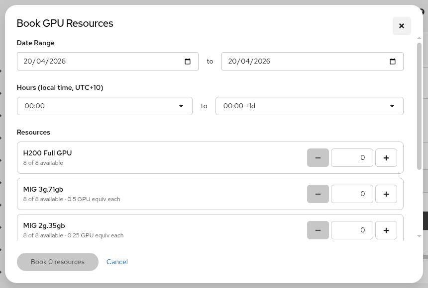
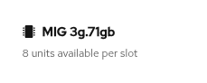
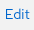
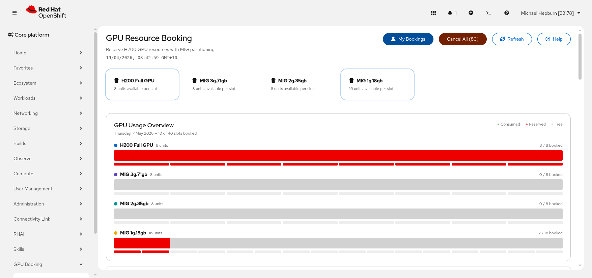
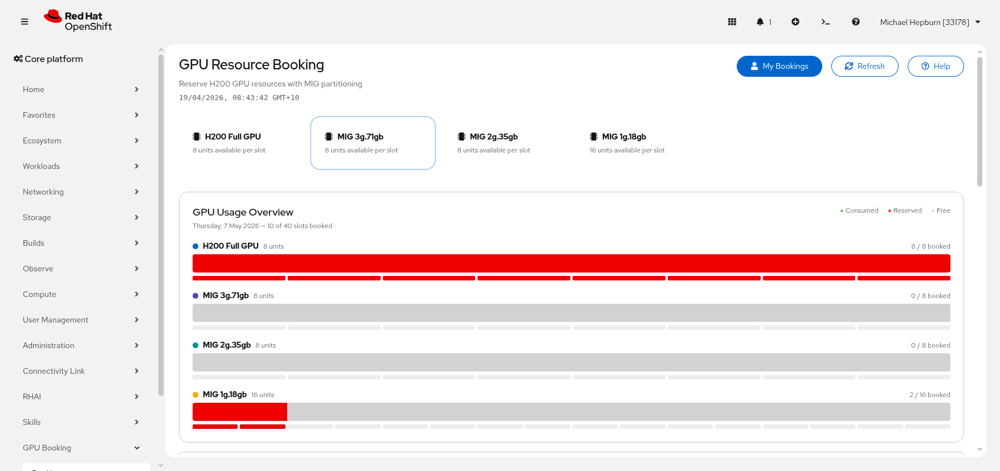
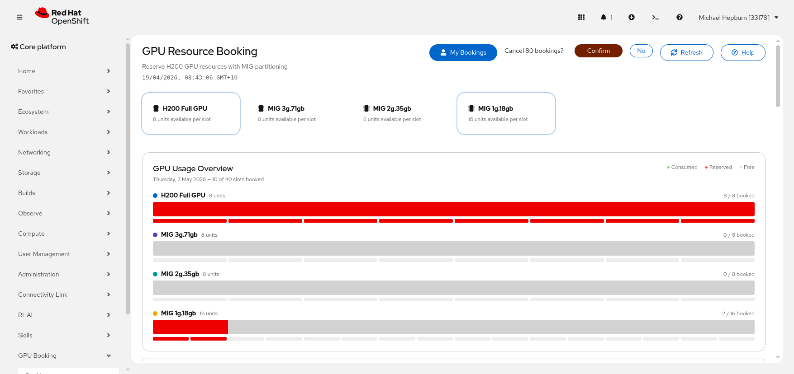
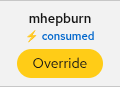

# Making Bookings

Topics: Book GPU, Edit, Cancel, Bulk Cancel, Override

## Creating a Booking

You can book GPU resources directly from the calendar. You can book multiple resources across multiple days.

To book GPU resources, right-click a date in the calendar and select **Book GPU** from the context menu.

This opens the booking dialog.

  <strong>Tip</strong>
  
Select multiple dates first (Ctrl+click or Shift+click in the calendar), then right-click to open the dialog — the date range will be pre-filled from your selection.

### Booking dialog fields

| Field | Description |
|-------|-------------|
| **Date Range** | Start and end dates for the booking. Pre-filled from your calendar selection, can be overridden. |
| **Hours** | Start and end hours in your local timezone. Defaults to full day (00:00 to 00:00 +1d). The UTC equivalent is shown below when not a full day. |
| **Resources** | +/- selectors for each GPU/MIG resource type. Shows available units and GPU equivalent weight per type. |
| **Description** | Free text field (max 160 characters) for noting the purpose of the booking (e.g., model training, inference testing). |

### GPU equivalents

The dialog shows a running total of GPU equivalents for your selection. A full GPU = 1.0 equivalent. MIG partitions are fractional, calculated from their memory relative to the full GPU.

### Availability

Each resource type shows how many units are available across your selected date range. Only reserved bookings count against availability — consumed (Kueue) bookings are shown but can be overridden and do not block your booking.

### Submitting

Click the **Book** button to create all bookings at once. The system auto-finds available slot indices for each resource, date, and hour range. Consumed bookings are automatically evicted to make room.

---

## System Bookings (Namespace Admins)

Cluster administrators and **namespace administrators** can create **system bookings** -- reservations for a namespace rather than for themselves, such as shared model-serving capacity. For example, reserving GPUs for the `shared-maas` namespace that hosts MaaS models. Any user who is an administrator of the target namespace (able to create RoleBindings in it) can create a system booking for it, so a team of namespace admins can manage reservations for their shared namespace without cluster-wide admin rights.

### Creating a system booking

1. Open the booking dialog (right-click a date and select **Book GPU**)
2. In the **Book as** section, select **System namespace**
3. Enter the target namespace (e.g. `shared-maas`)
4. Choose the date range, hours, and resources as usual
5. Click **Book**

  <strong>Tip</strong>
  
The namespace is validated against the cluster before the booking is created -- a typo returns a <code>namespace_not_found</code> error. If you are not an administrator of the target namespace, the booking is rejected with a <em>you are not an admin of namespace &lt;name&gt;</em> error.

### How system bookings appear

- The booking shows the **namespace name** in place of a username, with a blue **system** badge
- System bookings block user reservations exactly like any other reserved booking -- attempting to reserve a system-held slot returns a conflict
- Like user reservations, system bookings automatically evict consumed (Kueue) bookings when created
- System bookings created by you are shown under **My Bookings** (with a Cancel button), even though they are owned by the namespace
- Cancelling a system booking is done by its creator, any administrator of the target namespace (via the booking API), or a cluster administrator via the [Admin Dashboard](admin)

### Quota and expiry

System bookings behave identically to user reservations for cluster capacity: when active, a ClusterQueue scoped to the target namespace is created and the shared Cohort quota is reduced. Workloads in that namespace can use the reserved quota. When the booking expires, the reservation is drained and removed like any other.

---

## Editing a Booking

To modify an existing reservation:

1. Hover over your booking in the grid to reveal the **Edit** button
2. Click **Edit** to open the booking dialog pre-filled with the existing booking details
3. Adjust the dates, hours, resources, or description as needed
4. Click **Save Changes**

Under the hood, editing cancels the original booking and creates a new one. This allows you to change any aspect of the booking including the resource type, dates, and hours.

---

## Cancelling a Booking

To cancel one of your bookings:

1. Hover over your booking in the grid to reveal the **Cancel** button
2. Click **Cancel**, then click **Confirm** to proceed

You can only cancel your own reserved bookings. If you need to cancel someone else's booking, contact an administrator.

  <strong>Note</strong>
  
You cannot cancel bookings on past dates. Historical bookings are read-only.

---

## Bulk Cancel (Cancel All)

When you have many bookings across multiple dates and resource types, you can cancel them all at once using the **Cancel All** button.

### How to use

1. Click **My Bookings** in the toolbar — this shows all your reserved bookings and auto-selects the resource types you have bookings for

2. The **Cancel All (N)** button appears showing the total count of your reserved bookings across all selected resource types

### Filtering by resource type

If you only want to cancel bookings for specific resource types, use the **resource selector** to deselect the types you want to keep. The Cancel All count updates automatically to reflect only the selected resources.

For example, if you booked both full GPU and MIG resources but only want to cancel the MIG bookings, deselect the full GPU card from the resource selector.

### Confirmation

Clicking **Cancel All** shows a confirmation prompt. Click **Confirm** to proceed or **No** to go back.

  <strong>Tip</strong>
  
Bulk cancel only affects your own reserved bookings. Consumed (Kueue) bookings and other users' bookings are not affected.

---

## Overriding Kueue Bookings

When Kueue auto-creates bookings based on active GPU workloads, those slots show a lightning bolt label and an amber **Override** button.

Clicking **Override** will:

1. Remove the Kueue auto-booking
2. Create a reserved booking in its place under your username
3. The Kueue workload may be preempted to free up the resource for you (this happens once you use the resource you booked)

Reserved bookings always take priority over consumed bookings. This is useful when you need guaranteed access to a resource that is currently in use by an unreserved workload.

  <strong>How preemption works</strong>
  
Your reservation reduces the Cohort's available quota. Kueue will preempt the lowest-priority borrowing workload to honour your reservation. The workload will be re-queued and can resume when resources become available. Any preempted workloads will appear in the collapsible banner below the GPU Usage Overview.

---

## Active Reservations

When your booking has an active Kubernetes reservation (ClusterQueue + LocalQueue created for your quota), the booking cell shows a snake indicator with your namespace, e.g. `user-jsmith`.

This means your reserved quota is live in the cluster and Kueue will protect your workloads from preemption within that allocation.

---

## Auto-Refresh

The booking grid automatically refreshes every 30 seconds to show the latest bookings. You can also click the **Refresh** button in the header at any time.

---

## Error Handling

If a booking operation fails, an error banner appears at the top of the page. Common errors:

| Error | Meaning |
|-------|---------|
| `slot_taken` | Another user reserved this slot while you were viewing the page. Refresh and try a different slot. |
| `no_slots_available` | Not enough free units for the requested resource/date/hour combination. Reduce the count or try different dates. |
| `consumed_booking` | You tried to cancel a Kueue auto-booking. Use the Override button instead, or contact an admin. |
| `admin_required` | You tried to create a system booking without admin permissions. |
| `you are not an admin of namespace <name>` | You tried to create a system booking for a namespace you are not an administrator of. Ask a namespace or cluster admin to make the booking. |
| `invalid_namespace` | The system booking namespace is not a valid Kubernetes namespace name (lowercase letters, numbers, and dashes, max 63 characters). |
| `namespace_not_found` | The system booking namespace does not exist in the cluster. Check the spelling and try again. |
| Network error | The server may be temporarily unavailable. Try refreshing the page. |

---

## Next Steps

- [GPU Resources](gpu-resources) -- understand the different resource types and MIG partitions
- [Slot Types & Conflicts](slots-and-conflicts) -- learn how booking conflicts work
